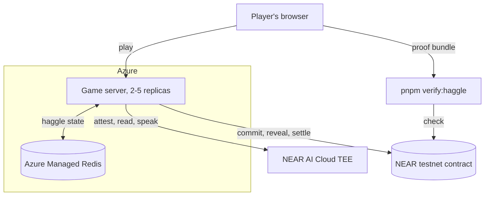
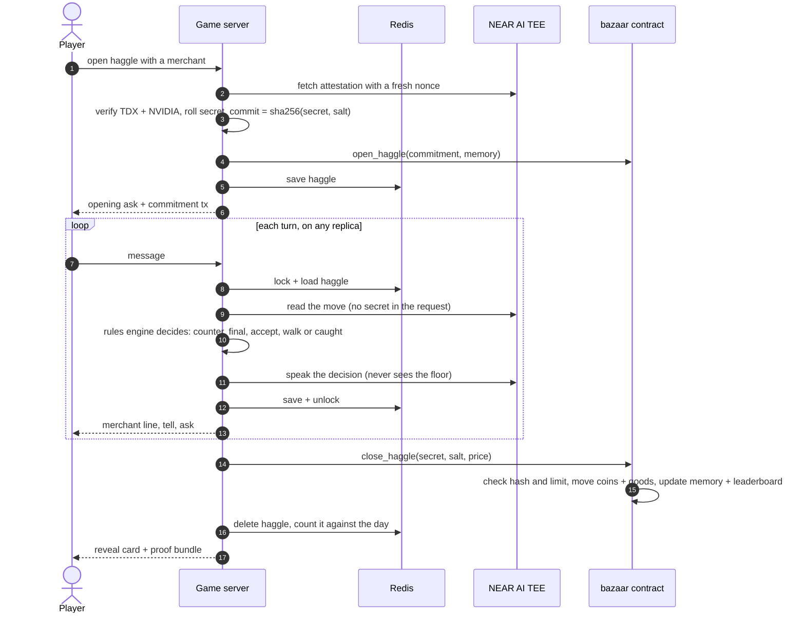

# Bazaar of Liars

A trading game against AI merchants who bluff. Read their tells, call their lies, buy low and sell high, and the chain proves every bluff was fair.
Built at NEAR HACKATHON (1–14 Nov 2026). Tracks: Games With Real Economies, Privacy & Private AI, Agent Economy.

## What it is

Each merchant holds a secret: its real limit (the lowest it sells for, or the most it pays) and what it really needs. You haggle in plain language.

- **Call their bluffs.** When a merchant swears "I can't go below 65", you can call it. Catch a liar and the price collapses. Accuse an honest merchant and they raise the price and make it final, or walk away.
- **Read their tells.** There's no mood meter. Each merchant leaks how close it is to its limit through its own body language: Farrukh tugs his beard, Zaria drums her rings, Tobin pushes up his spectacles. A merchant telling the truth about its limit looks firm.
- **Trade.** Each merchant sells one good and buys another. Buy a rug cheap from Farrukh, then sell it to Zaria, who might secretly want one badly. Six haggles a day; the top traders by peak purse are listed onchain.
- **They remember you.** Lowball a merchant and its next prices are worse; deal with it often and you get a friend's price. That memory lives in the contract, which checks it against every commitment.

When a haggle ends:

- the merchant's secret was **committed onchain before the haggle began**;
- every merchant reply was produced by a **TEE-hosted model on NEAR AI Cloud** and signed;
- a **NEAR contract** settles the trade only if the revealed secret matches the commitment and the price respects the limit.

Players never see a wallet or pay gas.

## Status

Done so far:
- the deterministic rules engine and secret commitments, with a terminal haggle and a balance simulator;
- the NEAR AI Cloud attestation verifier;
- LLM-voiced merchants with TEE-signed replies, plus a proof bundle and an independent verifier, all working live;
- the `bazaar` NEAR contract (commit, reveal-and-settle, memory, leaderboard, public expiry of unrevealed haggles), **live on testnet at [`v2.bazaar-liars.testnet`](https://testnet.nearblocks.io/address/v2.bazaar-liars.testnet)**. Every LLM haggle commits there before the first message and reveals there when it ends;
- the web game: a Three.js bazaar where you haggle in a chat panel, call bluffs, read tells and trade between stalls, then get a reveal card and the full fair-play evidence;
- the hosted demo on Azure Container Apps, with 2–5 server replicas sharing Azure Managed Redis.

The design is in [DESIGN.md](./DESIGN.md).

## Architecture



| Piece | What it is | What it does |
|---|---|---|
| Player's browser | Three.js bazaar + chat (`apps/web`), a guest id, no wallet | Plays, then downloads the proof bundle |
| Game server | `apps/server` + the rules engine in `packages/core`, on Azure Container Apps (2–5 replicas, image built in Azure Container Registry by `scripts/deploy-azure.sh`) | Attests the model, commits the secret, runs turns, reveals and settles. The only party that signs transactions, so players never pay gas |
| Azure Managed Redis | TLS, access key, persistence off | Holds live haggles (with their secret until revealed), market days, turn locks and rate limits, so any replica can serve the next turn |
| Container App secrets | NEAR AI key, `bazaar-server.testnet` key, Redis URL | Never in the image or the repo |
| NEAR AI Cloud | Qwen in an Intel TDX + NVIDIA TEE | Attestation, plus a signed reply for every read and every merchant line |
| NEAR testnet | [`v2.bazaar-liars.testnet`](https://testnet.nearblocks.io/address/v2.bazaar-liars.testnet) | Commitments, reveals, coins, goods, merchant memory, top traders |
| Verifier | `pnpm verify:haggle`, anyone, no API key | Replays the bundle and checks it against the chain |

Locally (`pnpm dev`) the same server keeps state in its own memory instead of Redis.

One haggle, end to end:



## Play it

**Hosted demo: https://bazaar-liars.delightfulwave-c85acb1b.northeurope.azurecontainerapps.io/** (testnet, no wallet needed). Open it and you should see a desert bazaar at dusk with three stalls. A merchant's reply can take 5–40 seconds while the TEE model answers.

To run it yourself you need Node 22 or later, pnpm, and a NEAR AI Cloud key in `.env`. Run `pnpm install`, then `pnpm dev`, and open http://localhost:5173.

1. Click **Tobin of the Lamps**, then **Buy the Brass Lamp**. The panel shows two steps: *Verifying the merchant's AI enclave (Intel TDX + NVIDIA)*, then *Sealing the merchant's secret on NEAR*. Then you see his asking price and a **🔒 Secret sealed on NEAR** link to the commitment transaction.
2. Type `This lamp has a dent. I'll give you 18`, then a few higher offers. He answers in character and counters. Watch his hands: polishing means he's at ease, pushing his spectacles up means he's nervous.
3. When he claims a limit ("not below 28"), a **Call the bluff** button appears. Press it. If he was lying, you see *Caught!* and the price drops toward his real floor. If he was telling the truth, he's offended and names a higher final price.
4. Click **Take it**. The reveal card flips to show his real floor and need, how much you left on the table, **every claim he made and whether it was true**, and what each of his tells meant ("firm · 16 from the limit"), with a **✓ Fair play verified** badge.
5. Click the badge. The evidence drawer lists the TEE attestation checks, the commitment and reveal transactions on testnet, and every replay check. **Download proof** saves the bundle, which you can check with `pnpm verify:haggle <file>`.
6. Back in the bazaar, click **Old Farrukh**, then **Sell your Brass Lamp**. Now he's buying: he opens low, and his secret is the most he'll pay.
7. The top bar counts down six haggles to sundown, then shows your day's profit and the **Top traders** board. The server keeps the day, so reloading the page doesn't reset it, and no new haggle opens until you press **Next day**. Your coins, goods and each merchant's memory of you are read from the contract, so they persist between visits.

For a production build, run `pnpm build && pnpm start`. The server serves the game on port 8787.

### Host it

Live haggles, market days and rate limits sit in a shared store: Redis when `REDIS_URL` is set, the server's memory otherwise. With Redis, any number of replicas can serve the same haggle (a per-haggle lock stops two of them playing the same turn) and a restart doesn't drop a game in progress. A turn can take 40 seconds, so the server runs as always-on containers, not serverless functions. The `Dockerfile` serves the game and the API on port 8080; secrets come from the host's environment (`NEARAI_API_KEY`, `SERVER_PRIVATE_KEY`), never from the image. To try it locally, run `docker build -t bazaar-liars .`, then `docker run -p 8080:8080 --env-file .env -v ~/.near-credentials:/home/node/.near-credentials:ro bazaar-liars`, and open http://localhost:8080.

The hosted demo runs on Azure Container Apps (resource group `bazaar-liars`, 2–5 replicas) backed by Azure Managed Redis, with the keys and the Redis URL stored as Container App secrets. To check the store against a real Redis, run `docker run -d -p 6390:6379 redis:7-alpine`, then `TEST_REDIS_URL=redis://localhost:6390 pnpm --filter @bazaar/server test`. To ship a new version, run `scripts/deploy-azure.sh`. It builds the image in Azure Container Registry, rolls the app and prints the URL.

## Try the pieces

1. Run `pnpm install`, then `pnpm test`. You should see 68 tests pass, including 3,000-haggle fuzz tests showing a merchant never sells below its secret floor and never pays above its secret ceiling, with bluffs being called.
2. Run `pnpm haggle`. A merchant prints a **commitment hash**, then an opening price. Type an offer (e.g. `40`), claim a competitor's price (`40 saw 35`), call a claimed minimum (`liar`), or `take`. When the haggle ends, the secret floor and need are revealed and checked against the commitment, and you see `✓ fair play verified`.
3. Run `pnpm sim`. You should see a table of scripted bot strategies against each merchant: deal rate, walk-away rate, and how much each one overpaid above the hidden floor. `sharp` (calls bluffs unless the merchant looks firm) should beat both `caller` (calls everything) and `splitter` (never calls) against every merchant. Calling blindly only pays against heavy bluffers like Farrukh.
4. Copy `.env.example` to `.env` and set `NEARAI_API_KEY` (from cloud.near.ai). Then run `pnpm verify:model`. It fetches a TEE attestation for the merchant model with a fresh random nonce and prints a **Verified panel** with these checks:
   - **Intel TDX:** the quote's signature chains to Intel (checked with dcap-qvl against Intel's PCS), the TEE isn't in debug mode, and the container manifest matches `mr_config_id`.
   - **Signing key:** the key that will sign merchant replies, plus our nonce, is bound into the TDX report data.
   - **NVIDIA GPUs:** NVIDIA's NRAS verdict and each GPU's report, with every JWT verified against NVIDIA's JWKS.

   You should see `✓ VERIFIED — trusted signers: 0x…`. Attestation is free and needs no credits. Use `--offline` to skip the Intel and NVIDIA network calls, or `--json out.json` to save the full bundle.
5. **No API key needed:** run `pnpm verify:haggle examples/sample-haggle.json`. This replays a real haggle with Old Farrukh, settled on testnet, where he claimed "not below 65", got called, was caught bluffing, and dropped to 54 (his real floor was 47). It checks 49 things, including:
   - the revealed secret matches the commitment;
   - the commitment is in the `bazaar-liars.testnet` contract, and its block came **before** the merchant's first TEE-signed reply;
   - the contract settled the deal and revealed the same secret as the bundle;
   - every model call is TEE-signed by an attested key;
   - a full rules-engine replay reproduces every decision, including the called bluff;
   - the model was never told the floor;
   - the deal is at or above the floor.

   You should see `✓ FAIR PLAY VERIFIED`. The onchain checks read testnet RPC, so they need a network but no key; add `--no-chain` to skip them. Edit any number in the file (the `floor`, say) and run it again to see the checks fail.
6. **Needs credits:** run `pnpm haggle:llm` (or `pnpm haggle:llm -- zaria`) and haggle in plain English, e.g. `I'll give you 30, the stall by the well sells it for 40`. Type `take` to accept or `leave` to walk away. Replies take about 0.5–2 s. With `BAZAAR_CONTRACT_ID` and `SERVER_ACCOUNT_ID` set in `.env` (plus that account's key in `~/.near-credentials/testnet/`, or `SERVER_PRIVATE_KEY`), you also see a nearblocks link for the commitment before the first message, and one for the reveal at the end. At the end you see the real floor and need, `✓ Fair play verified`, and a proof bundle written to `haggles/`.

7. **Needs Rust:** run `pnpm test:contract`. You should see 21 contract tests pass, including:
   - the contract's commitment hash matches the TypeScript one byte for byte (shared vectors in both test suites);
   - a sale below the committed floor, or a purchase above the committed ceiling, is rejected;
   - the server can't invent a grudge: memory in a commitment must match the contract's own record;
   - a good you're selling is escrowed, and returned if there's no deal;
   - a reveal with a changed floor or wrong salt is rejected;
   - only the game server can open or close a haggle;
   - if the server never reveals, anyone can expire the haggle after about an hour, and it's counted publicly in `stats().unrevealed`.

## Repo layout

```
apps/web         Three.js bazaar + chat haggle UI (Vite)
apps/server      haggle API: attest → commit onchain → signed turns → reveal + settle;
                 store.ts keeps live haggles and market days (Redis or memory)
packages/core    rules engine, secrets, commitments
packages/verify  offline fair-play verifier
contracts/       bazaar contract (Rust, near-sdk)
scripts/         NEAR AI check, Azure redeploy
Dockerfile       one image: game + API on port 8080
```

## Honest limits

The game server can see a merchant's secret during a haggle. The design guarantees that the secret can't *change* and that the deal *respects* it. It doesn't guarantee the secret stays hidden from the server's operator. See DESIGN.md, "What it doesn't prove".

## License

MIT
