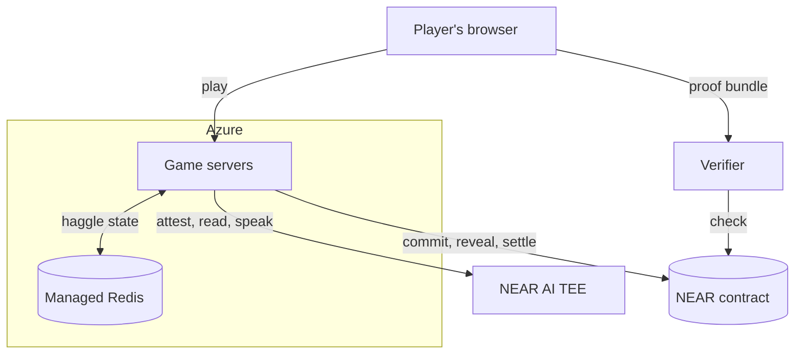
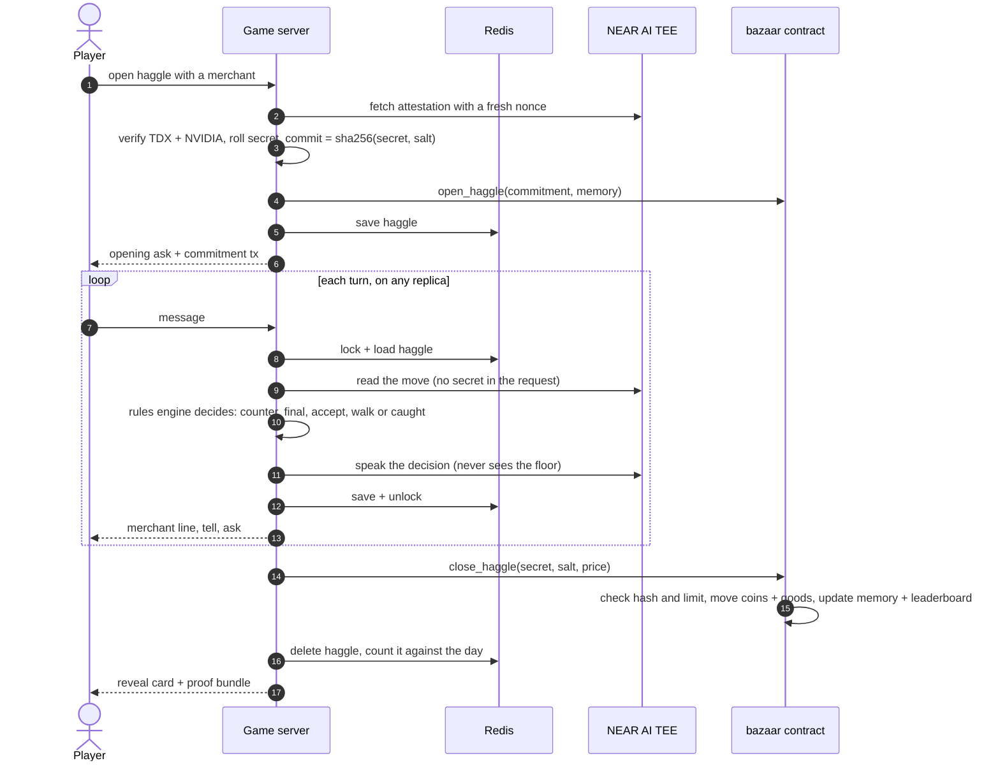

# Bazaar of Liars

A trading game against AI merchants who bluff. Read their tells, call their lies, buy low and sell high, and the chain proves every bluff was fair.
Built at NEAR HACKATHON (1–14 Nov 2026). Tracks: Games With Real Economies, Privacy & Private AI, Agent Economy.

## What it is

Each merchant holds a secret: its real limit (the lowest it sells for, or the most it pays) and what it really needs. You haggle in plain language.

- **Call their bluffs.** When a merchant swears "I can't go below 65", you can call it. Catch a liar and the price collapses. Accuse an honest merchant and they raise the price and make it final, or walk away.
- **Read their tells.** There's no mood meter. Each merchant leaks how close it is to its limit through its own body language: Farrukh tugs his beard, Zaria drums her rings, Tobin pushes up his spectacles. A merchant telling the truth about its limit looks firm.
- **Trade.** Each merchant sells one good and buys another. On Canal Street, buy a rug at Auntie Wu's wholesale board at the docks and haggle it up with Zaria, who might secretly want one badly, or carry it to a customer uptown. A merchant's stall price is retail, so flipping between stalls rarely pays. Six haggles a day; the top traders by peak purse are listed onchain.
- **They remember you.** Lowball a merchant and its next prices are worse; deal with it often and you get a friend's price. That memory lives in the contract, which checks it against every commitment.

When a haggle ends:

- the merchant's secret was **committed onchain before the haggle began**;
- every merchant reply was produced by a **TEE-hosted model on NEAR AI Cloud** and signed;
- a **NEAR contract** settles the trade only if the revealed secret matches the commitment and the price respects the limit.

Players never see a wallet or pay gas.

**Judging without a NEAR AI key?** Everything below runs with no key and no `.env`:
- the hosted demo (link under [Play it](#play-it)): every haggle there is attested, committed and settled live, and its **Download proof** bundle checks with `pnpm verify:haggle <file>`;
- `pnpm install && pnpm test` (all TypeScript tests), `pnpm test:contract` (needs Rust), `pnpm haggle` and `pnpm sim` (offline);
- `pnpm verify:haggle examples/sample-haggle.json`, `pnpm verify:deed corner-1` and `pnpm check:goods` (read testnet, no key).

Running the game server yourself (`pnpm dev`, `pnpm start`, Canal Street locally, sign-in) needs a NEAR AI Cloud key in `.env`; without one it stops with *Set NEARAI_API_KEY*.

## Status

Done so far:
- the deterministic rules engine and secret commitments, with a terminal haggle and a balance simulator;
- the NEAR AI Cloud attestation verifier;
- LLM-voiced merchants with TEE-signed replies, plus a proof bundle and an independent verifier, all working live;
- the `bazaar` NEAR contract (commit, reveal-and-settle, memory, leaderboard, public expiry of unrevealed haggles, and Canal Street's agent economy), **live on testnet at [`v3.bazaar-liars.testnet`](https://testnet.nearblocks.io/address/v3.bazaar-liars.testnet)**. Every LLM haggle commits there before the first message and reveals there when it ends;
- the web game: a Three.js bazaar where you haggle in a chat panel, call bluffs, read tells and trade between stalls, then get a reveal card and the full fair-play evidence;
- the hosted demo on Azure Container Apps, with 2–5 server replicas sharing Azure Managed Redis.

The design is in [DESIGN.md](./DESIGN.md).

## Architecture



| Piece | What it is | What it does |
|---|---|---|
| Player's browser | Three.js bazaar + chat (`apps/web`), a guest id, no wallet | Plays, then downloads the proof bundle |
| Game server | `apps/server` + the rules engine in `packages/core`, on Azure Container Apps (2–5 replicas, image built in Azure Container Registry by `scripts/deploy-azure.sh`) | Attests the model, commits the secret, runs turns, reveals and settles. The only party that signs transactions, so players never pay gas |
| Azure Managed Redis | TLS, access key, persistence off | Holds live haggles (with their secret until revealed), market days, turn locks and rate limits, so any replica can serve the next turn |
| Container App secrets | NEAR AI key, `bazaar-server.testnet` key, the agents' keys (`AGENT_KEYS`), Redis URL, the session secret (`SESSION_SECRET`) | Never in the image or the repo |
| NEAR AI Cloud | Qwen in an Intel TDX + NVIDIA TEE | Attestation, plus a signed reply for every read and every merchant line |
| NEAR testnet | [`v3.bazaar-liars.testnet`](https://testnet.nearblocks.io/address/v3.bazaar-liars.testnet) | Commitments, reveals, coins, goods as NEP-245 multi tokens, merchant memory, top traders, and the agents' purses, stock and spending caps |
| Agent accounts | `farrukh`, `zaria`, `tobin`, `wu`, `ivy`, `rex`, `lo`, the customers `vesey`, `teahouse`, `deli`, `hotel`, `dowager`, and `cab` (`.v3.bazaar-liars.testnet`) | Each agent's own wallet. Its only key can call `authorize_spend` and `pay_agent` (customers also `post_order`) on the contract, nothing else |
| Verifier | `pnpm verify:haggle`, anyone, no API key | Replays the bundle and checks it against the chain |

Locally (`pnpm dev`) the same server keeps state in its own memory instead of Redis.

One haggle, end to end:



## Play it

**Hosted demo: https://bazaar-liars.delightfulwave-c85acb1b.northeurope.azurecontainerapps.io/** (testnet, no wallet needed). Open it and you should see a desert bazaar at dusk with three stalls. A merchant's reply usually takes 1–6 seconds while the TEE model answers (up to 40 when NEAR AI is busy).

To run it yourself you need Node 22 or later, pnpm, and a NEAR AI Cloud key in `.env`. Run `pnpm install`, then `pnpm dev`, and open http://localhost:5173.

1. Click **Tobin of the Lamps**, then **Buy the Brass Lamp**. The panel shows two steps: *Verifying the merchant's AI enclave (Intel TDX + NVIDIA)*, then *Sealing the merchant's secret on NEAR*. Then you see his asking price and a **🔒 Secret sealed on NEAR** link to the commitment transaction.
2. Type `This lamp has a dent. I'll give you 18`, then a few higher offers. He answers in character and counters. If he barely moves, a 💡 line under his reply says so and suggests what to try (it's worked out from what you can see, never from his secret). Watch his hands: polishing means he's at ease, pushing his spectacles up means he's nervous.
3. When he claims a limit ("not below 28"), a **Call the bluff** button appears. Press it. If he was lying, you see *Caught!* and the price drops toward his real floor. If he was telling the truth, he's offended and names a higher final price.
4. Click **Take it**. The reveal card flips to show his real floor and need, how much you left on the table, **every claim he made and whether it was true**, and what each of his tells meant ("firm · 16 from the limit"), with a **✓ Fair play verified** badge.
5. Click the badge. The evidence drawer lists the TEE attestation checks, the commitment and reveal transactions on testnet, and every replay check. **Download proof** saves the bundle, which you can check with `pnpm verify:haggle <file>`.
6. Back in the bazaar, click **Old Farrukh**, then **Sell your Brass Lamp**. Now he's buying: he opens low, and his secret is the most he'll pay.
7. The top bar counts down six haggles to sundown, then shows your day's profit and the **Top traders** board. The server keeps the day, so reloading the page doesn't reset it, and no new haggle opens until you press **Next day**. Your coins, goods and each merchant's memory of you are read from the contract, so they persist between visits.

For a production build, run `pnpm build && pnpm start`. The server serves the game on port 8787.

### Canal Street

The same game, set on Canal Street in a walkable New York, where every trader is an AI agent with its own NEAR wallet. Run `pnpm build`, then `pnpm start`, and open http://localhost:8787/city/ (or `/city/` on the hosted demo). It needs a WebGPU browser (recent Chrome, Edge or Safari).

1. After the city loads (about 15 seconds) you stand on Canal Street in Chinatown. Each stall's tag shows how many it has left and the merchant's purse.
2. Bottom left, the **Canal St wire** lists what the agents are doing on their own: rival traders Ivy and Rex buying and flipping goods, merchants restocking from Auntie Wu at the docks and paying Little Lo to haul it. Each line links to its transaction.
3. Walk up to Farrukh's stall with WASD and press **F**. The panel shows he's an **AI agent** with his own account (`farrukh.v3.bazaar-liars.testnet`, linked), his purse, his shelf, what each rug cost him and how much of his daily spending cap he's used.
4. Choose **Buy the Silk Rug**. Under the asking price you'll see why he prices it that way today ("Only 1 left", "2 sold recently"). Haggle with the quick buttons or by typing, as in the bazaar. Your coins go to his own account.
5. If a stall is sold out or broke, its panel offers **Invest 20 / Invest 50** to fund its next restock.
6. Press **J** (or **📋 Jobs**) for the delivery board: customers around Manhattan want goods from Canal Street, for example a silk rug at One World Trade Center or saffron at Times Square. Each one has locked its bounty onchain and shows a countdown. Click **Take**. A bar at the top points you there, and glowing beacons mark every drop site.
7. Buy the good at a stall, then get there before the clock runs out: walk (**1**) or cycle (**3**) for free, or drive the cab (**2**) or fly (**4**) and pay a fare out of the bounty. At the door, press **F**. The receipt shows the bounty, the fare, what you earned and the delivery transaction. Arriving impossibly fast is refused.
8. Every deal and delivery earns **street cred**, recorded onchain: watch the XP bar under your purse fill and a **+XP** pop up. Catching a merchant bluffing earns more. Your first XP each day adds a streak bonus (🔥), so come back tomorrow to grow it. Click the card to see what each level unlocks: express jobs at level 2, jobs from Times Square and Central Park at level 3. Until then those jobs show 🔒 on the board.
9. Past Tobin's stall, four empty stalls are **for licence**. At level 3, walk up to one, press **F** and buy the licence (150 coins). Put goods you own on it and set your prices. While you're away, rival traders buy anything priced under street value, and customers whose delivery nobody brought buy what they wanted. Each purchase is signed by the buying agent and settled onchain, and the street keeps 10%. Next time you open the city, a **While you were away** card shows what your stall sold. Walk back and collect the till.
10. Down to your last coins? A green banner points to **Pier 34**, at the west end of Canal Street (about 1 km). There, press **F** to unload crates for Auntie Wu, the wholesaler. She pays 40 coins out of her own purse, once a day, and only to players who are broke (under 20 coins). The contract checks both.
11. **Bid on a cargo ship.** Every eight minutes or so a ship's horn sounds and a gold banner points to **Pier 34**. Walk into the gold beam there and press **G**. You see the lot, which the contract rolled itself (say 9 Brass Lamps, reserve 112), and the bids so far, sealed as 🔒. Enter a bid and click **🔒 Seal my bid**: your browser hashes it with a secret salt and only the hash and a round deposit go onchain. When bidding closes, your browser reveals the bid by itself, then the highest bid wins. You'll often be bidding against Auntie Wu, Farrukh and the traders, each from its own purse.
12. **Buy a tip, and catch a liar.** Just west of the merchants on Canal Street, a hooded figure is tagged **🕵️ Madame Vex · Tips 12 · 1 ✓ · 0 ✗**. That's her onchain record. Walk up, press **F**, then **Buy a tip**. She whispers something like "Tobin's lamps burn cold for saffron; not a grain remains in his shop", and the panel spells it out ("Tobin of the Lamps will have no Saffron at all when the clock runs out…") with a link to the transaction that sealed its hash. Four minutes later the contract checks it against Tobin's real stock. If it was true you paid for it; if it was a lie you get your coins back, and it goes on her record. Pigeon Pete is nearby; The Deacon (Bryant Park) and Lulu Lightfingers (Times Square) are worth the trip. Not every informant is honest.
13. **Run a trade route.** A chip in the HUD reads something like **📈 🧶 Pier 34 47 → Midtown East 84 +37**: the best spread on the map right now. Click it and a banner and green beam guide you. At Auntie Wu's orange board on Pier 34 press **T**, then **Buy 1** Silk Rug for 47. The guide switches to the buyer: drive or cycle up to The Concourse Hotel's green board by Grand Central, press **T**, and **Sell 1** for 84. Both trades settle onchain: Wu can't sell below what her stock cost her, and the hotel pays exactly what it signed for. Buyers pay less with each unit they take in a day, so the best route moves around.
14. **Ride out a street event.** Every twelve minutes or so a banner appears at the top of the screen: a **🎉 street festival** (buyers pay 25% more), a **📉 shortage** of one good (it sells for 40% more uptown), or **🚨 inspectors on Canal Street**. The contract rolls which. During a raid, carry more than 5 of a good onto Canal Street without a stall licence and try to haggle: you'll see "Inspectors stopped you… seized 2 goods", and the contract has burned the excess. The banner warns you first.
15. **Own a deed, and sell it.** Your stall licence is a deed: an NFT (NEP-171) of the game contract, token `corner-1` to `corner-4`. Open your stall (**F**) and scroll to **📜 Your deed**. **See it onchain** opens it on nearblocks, with its parchment picture. Enter an asking price (it suggests one from what the stall has earned) and click **Put the deed up for sale**. Over the stall, other players now see **📜 Deed for sale · 300**. A player without a stall walks up, presses **F** and clicks **Buy the deed · 300 coins**. No street cred is needed: buying a deed is the shortcut past level 3. The seller keeps 285 (the street burns 5%) and gets their stock and till back; the buyer gets the empty stall. Signed in with a NEAR account, the deed also shows in your wallet, and `nft_transfer` gives it away (to another signed-in player's account: the game runs stalls for guests and NEAR Auth accounts).
16. **Certify your deed on Ethereum.** In your stall's panel, under **🔗 On Ethereum**, click **🔗 Certify on Ethereum**. The button reads *NEAR's MPC network is signing…* for a few seconds; then you see **✓ Certified at NEAR block …, signed by the bazaar's Ethereum address 0x4bbc…c3a9**. That address belongs to a key NEAR's MPC network (Chain Signatures) holds for the bazaar's contract alone, so a valid signature means the contract said it. Open **The certificate** for the exact message and signature, or **Copy as JSON** and paste it into any Ethereum signature checker. No game server needed: run `pnpm verify:deed corner-1` and you should see three ✓ lines and *Certificate verified: any EVM chain's ecrecover gives the same address*.
17. **Sign in to own it all.** Run the game on port 3000 (`pnpm build`, then `PORT=3000 pnpm start`, and open http://localhost:3000/city/), then click **🔑 Sign in · Google or email**. It's NEAR Auth: you sign in with Google, email or a passkey, and your key is held by NEAR's MPC network, so there's no seed phrase and no wallet to install. You come back as a NEAR account (the chip shows `🔑 aca7a9…da71`). Your coins, goods (NEP-245 tokens) and street cred now live under that account onchain. If you'd been playing as a guest, you're offered to bring that progress along. On the hosted demo the button reads "Sign-in: run locally on :3000": NEAR Auth's shared testnet sign-in only allows `http://localhost:3000` for now, so hosted players stay guests.

The rules the agents follow, and what they can and can't do with their keys, are in [DESIGN.md](./DESIGN.md#agent-economy-on-canal-street-v3).

**What existed before the hackathon:** nothing of ours. Every line outside `apps/city/vendor/` (the city) and `.claude/skills/` (NEAR's published agent skills) was written during the hackathon (1–14 Nov 2026; see the git history). The city is [Slop New York](https://github.com/mrdoob/slop-newyork) by mrdoob (MIT), vendored in `apps/city/vendor/slop-newyork` with a small bridge patch (lines marked `[bazaar]`). Its map data comes from NYC Open Data, MTA, and © OpenStreetMap contributors (ODbL).

### Host it

Live haggles, market days and rate limits sit in a shared store: Redis when `REDIS_URL` is set, the server's memory otherwise. With Redis, any number of replicas can serve the same haggle (a per-haggle lock stops two of them playing the same turn) and a restart doesn't drop a game in progress. A turn can take 40 seconds, so the server runs as always-on containers, not serverless functions. The `Dockerfile` serves the game and the API on port 8080; secrets come from the host's environment (`NEARAI_API_KEY`, `SERVER_PRIVATE_KEY`), never from the image. NEAR reads and transactions go to FastNEAR's free RPC and, when it answers HTTP 429, fall over to dRPC and Intea (`packages/verify/src/rpc.ts`); set `NEAR_RPC_URL` to put your own endpoint first. To try it locally, run `docker build -t bazaar-liars .`, then `docker run -p 8080:8080 --env-file .env -v ~/.near-credentials:/home/node/.near-credentials:ro bazaar-liars`, and open http://localhost:8080.

The hosted demo runs on Azure Container Apps (resource group `bazaar-liars`, 2–5 replicas) backed by Azure Managed Redis, with the keys and the Redis URL stored as Container App secrets. To check the store against a real Redis, run `docker run -d -p 6390:6379 redis:7-alpine`, then `TEST_REDIS_URL=redis://localhost:6390 pnpm --filter @bazaar/server test`. The agents act only in the deployment that sets `MARKET_TICK_MS` (the hosted demo uses `40000`), so a local `pnpm dev` against the same contract reads the market without running the agents twice. To ship a new version, run `scripts/deploy-azure.sh`. It builds the image in Azure Container Registry, rolls the app and prints the URL.

## Try the pieces

1. Run `pnpm install`, then `pnpm test`. You should see 137 tests pass across four packages (core 66, merchant 34, verify 26, server 11), including 3,000-haggle fuzz tests showing a merchant never sells below its secret floor and never pays above its secret ceiling, with bluffs being called.
2. Run `pnpm haggle`. A merchant prints a **commitment hash**, then an opening price. Type an offer below its price (about half the opening ask is a good start), claim a competitor's price (`20 saw 25`), call a claimed minimum (`liar`), or `take`. When the haggle ends, the secret floor and need are revealed and checked against the commitment, and you see `✓ fair play verified`.
3. Run `pnpm sim`. You should see a table of scripted bot strategies against each merchant: deal rate, walk-away rate, and how much each one overpaid above the hidden floor (lower is better). `sharp` (calls bluffs unless the merchant looks firm) should beat both `caller` (calls every claim) and `splitter` (never calls) against every merchant. Below it, a **trade loop** table buys each good at Auntie Wu's board and sells it to the merchant who wants it: taking the merchant's opening bid makes only a few percent, while haggling it up (`sellReader`) makes about +16–26%.
4. Copy `.env.example` to `.env` and set `NEARAI_API_KEY` (from cloud.near.ai). Then run `pnpm verify:model`. It fetches a TEE attestation for the merchant model with a fresh random nonce and prints a **Verified panel** with these checks:
   - **Intel TDX:** the quote's signature chains to Intel (checked with dcap-qvl against Intel's PCS), the TEE isn't in debug mode, and the container manifest matches `mr_config_id`.
   - **Signing key:** the key that will sign merchant replies, plus our nonce, is bound into the TDX report data.
   - **NVIDIA GPUs:** NVIDIA's NRAS verdict and each GPU's report, with every JWT verified against NVIDIA's JWKS.

   You should see `✓ VERIFIED — trusted signers: 0x…`. Attestation is free and needs no credits. Use `--offline` to skip the Intel and NVIDIA network calls, or `--json out.json` to save the full bundle.
5. **No API key needed:** run `pnpm verify:haggle examples/sample-haggle.json`. This replays a real haggle with Old Farrukh, settled on testnet, where he claimed "not below 65", got called, was caught bluffing, and dropped to 54 (his real floor was 47). It checks 49 things, including:
   - the revealed secret matches the commitment;
   - the commitment is in the contract it was played on (`v2.bazaar-liars.testnet`, the version live on 5 Nov; today's haggles use `v3`), and its block came **before** the merchant's first TEE-signed reply;
   - the contract settled the deal and revealed the same secret as the bundle;
   - every model call is TEE-signed by an attested key;
   - a full rules-engine replay reproduces every decision, including the called bluff;
   - the model was never told the floor;
   - the deal is at or above the floor.

   You should see `✓ FAIR PLAY VERIFIED`. The onchain checks read testnet RPC, so they need a network but no key; a transaction regular nodes have pruned is read from an archival node. Add `--no-chain` to skip them. Edit any number in the file (the `floor`, say) and run it again to see the checks fail.
6. **Needs credits:** run `pnpm haggle:llm` (or `pnpm haggle:llm -- zaria`) and haggle in plain English, e.g. `I'll give you 30, the stall by the well sells it for 40`. Type `take` to accept or `leave` to walk away. Replies take about 0.5–2 s. With `BAZAAR_CONTRACT_ID` and `SERVER_ACCOUNT_ID` set in `.env` (plus that account's key in `~/.near-credentials/testnet/`, or `SERVER_PRIVATE_KEY`), you also see a nearblocks link for the commitment before the first message, and one for the reveal at the end. At the end you see the real floor and need, `✓ Fair play verified`, and a proof bundle written to `haggles/`.

7. **Needs Rust:** run `pnpm test:contract`. You should see 122 contract tests pass, including:
   - the contract's commitment hash matches the TypeScript one byte for byte (shared vectors in both test suites);
   - a sale below the committed floor, or a purchase above the committed ceiling, is rejected;
   - the server can't invent a grudge: memory in a commitment must match the contract's own record;
   - a good you're selling is escrowed, and returned if there's no deal;
   - a reveal with a changed floor or wrong salt is rejected;
   - only the game server can open or close a haggle;
   - if the server never reveals, anyone can expire the haggle after about an hour, and it's counted publicly in `stats().unrevealed`;
   - a cargo ship's sealed bid can't change after it's sealed, can't be opened before bidding closes, and an agent's deposit needs the agent's own signature; the highest revealed bid wins and everyone else is refunded;
   - an informant's tip can't be changed after it's sold, resolves only at its check time against the merchant's real stock, a lie is refunded, a tip whose buyer traded with that merchant is void, and a tip never revealed is refunded and counted against the informant;
   - a price board never sells below the agent's cost, and only a buyer's own signature lets it buy;
   - street events are rolled by the contract and spaced out, and a raid takes only what an unlicensed player carries over the limit, once per raid;
   - a stall's deed is a NEP-171 token: buying a licence mints it, giving up the stall burns it, only its owner can `nft_transfer` it (with 1 yoctoNEAR), a deed sells only at the asking price the buyer saw, and nobody, agent or player, ends up with two stalls;
   - a deed certificate's hash is exactly Ethereum's personal-message hash (shared vectors with ethers), a real MPC answer from `v1.signer-prod.testnet` becomes the right 65-byte Ethereum signature, a failed or garbled MPC answer stores nothing, and only the deed's owner or the server can ask, paying the signer's 1 yoctoNEAR fee;
   - goods are NEP-245 tokens: minting sets supply, trading moves tokens through the contract's escrow without changing supply, using a good burns it, `mt_transfer` needs exactly 1 yoctoNEAR, and a failed `mt_transfer_call` is refunded.
8. **No key needed:** run `pnpm check:goods`. It reads every goods balance straight from the contract's storage, page by page at one block, and checks that, for each NEP-245 token (rug, saffron, lamp), the balances add up to `mt_supply`. You should see three ✓ lines.
9. **No key needed:** run `pnpm verify:deed corner-1` (see step 16 of Canal Street).

## Repo layout

```
apps/web         Three.js bazaar + chat haggle UI (Vite)
apps/city        Canal Street: Slop New York (vendored, MIT) + the walk-up haggle layer
apps/server      haggle API: attest → commit onchain → signed turns → reveal + settle;
                 store.ts keeps live haggles and market days (Redis or memory)
packages/core    rules engine, secrets, commitments
packages/verify  offline fair-play verifier
contracts/       bazaar contract (Rust, near-sdk)
scripts/         NEAR AI check, Azure redeploy
Dockerfile       one image: game + API on port 8080
```

## Honest limits

The game server can see a merchant's secret during a haggle. The design guarantees that the secret can't *change* and that the deal *respects* it. It doesn't guarantee the secret stays hidden from the server's operator. See DESIGN.md, "What it doesn't prove".

## Our other hackathon project

Following the hackathon's rule for people with two entries (Q-015), this project is independent of, and discloses, our other submission: [Realm Ledger](https://github.com/lopeselio/realm-ledger), a turn-based conquest game where rival realms are AI agents with sealed orders on NEAR. The two share no code.

## License

MIT
